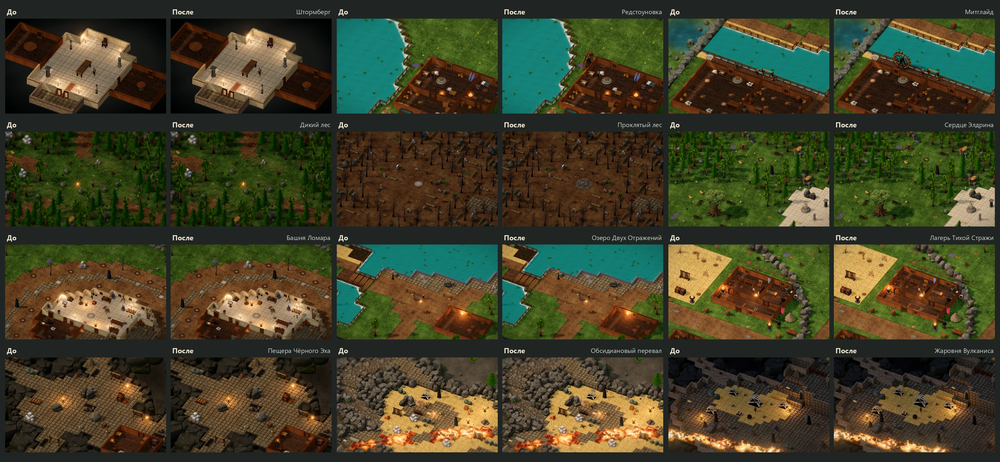
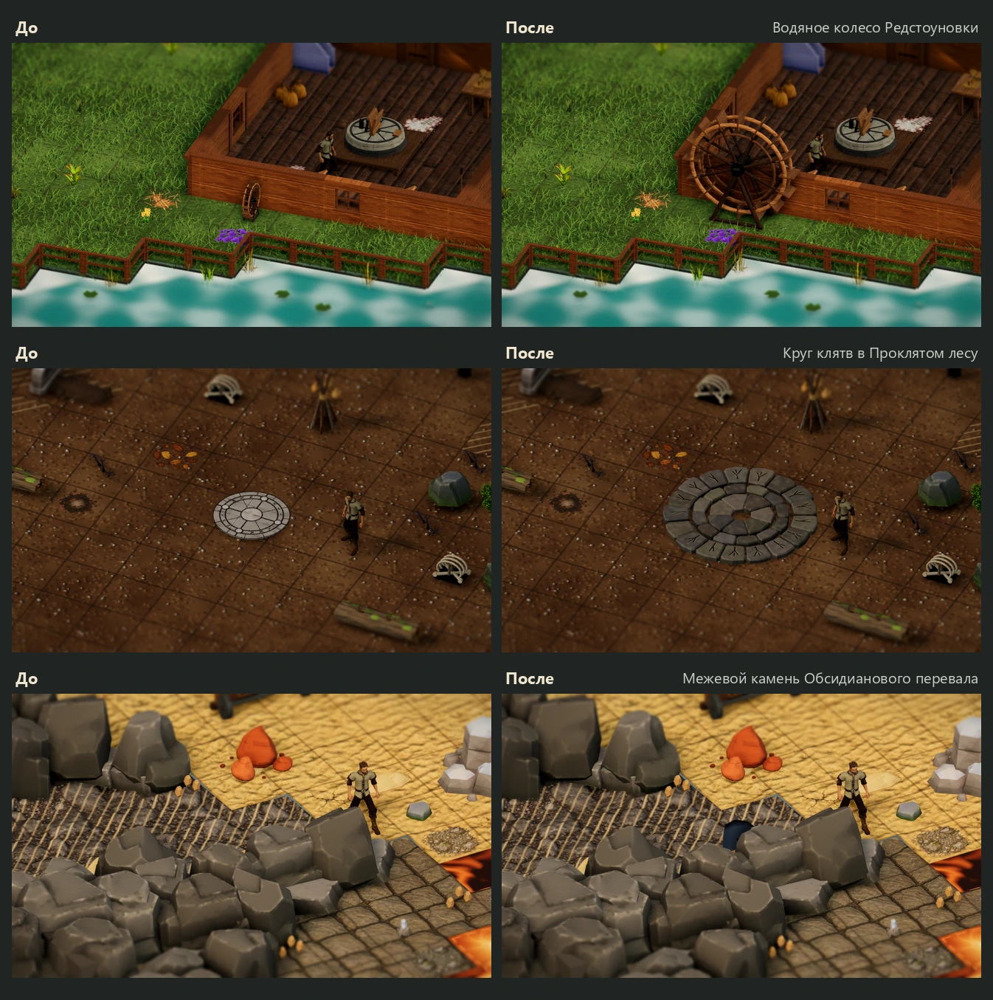
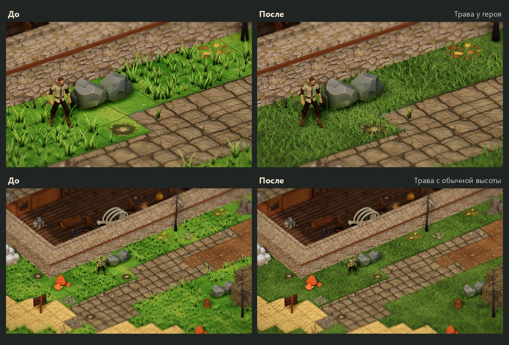

# Визуальный обзор локаций «Асстоханских равнин»

Проверены двенадцать оставшихся авторских локаций. Для каждой пары использованы
одна и та же карта, камера, освещение и положение героя. Кадры сняты настоящим
WebGL-рендерером с загруженными GLB-моделями, а карта полностью раскрыта только
для визуального аудита.

## Исправленные предметы

В Редстоуновке и Митглайде водяные колёса были развёрнуты в плоскости,
соответствующей их GLB. Runtime теперь меняет ширину и глубину после штатного
поворота модели, поэтому колесо занимает длинную сторону отведённого места.

В Проклятом лесу ритуальный круг был ровной светлой наклейкой. Авторский круг
клятв теперь состоит из трёх рядов неровной каменной вымостки с внутренними
насечками. При первом рендере обнаружился GLSL-конфликт с зарезервированным
именем переменной 'patch'. Имя исправлено, свежий кадр проверен без ошибок
шейдера.

В Обсидиановом перевале объект 'old-boundary-stone' получает цельный
многогранный корпус с неровным сколом и потёртыми зарубками. Футпринт и
коллизия не меняются. Остальные 'broken_obelisk' сохраняют общий вид.

## Трава

Активная трава строится только на раскрытых проходимых клетках с
'material: grass' и 'surface: none'. Из аудита исключены вода, непроходимые
клетки, дороги и интерьерные зоны.

| Локация | Клетки | Инстансы | Результат |
| --- | ---: | ---: | --- |
| Сердце Элдрина | 2 553 | 8 848 | вода исключена |
| Башня Ломара | 2 181 | 18 621 | интерьеры исключены |
| Озеро Двух Отражений | 3 053 | 27 309 | береговые покрытия исключены |
| Митглайд | 2 003 | 18 074 | река и дома исключены |
| Лагерь Тихой Стражи | 2 282 | 20 318 | дороги и помещения исключены |
| Редстоуновка | 3 631 | 30 416 | пруд исключён |
| Пещера Чёрного Эха | 201 | 1 795 | трава только на открытом склоне |
| Дикий лес | 5 076 | 8 575 | тропы и хижина исключены |

В Проклятом лесу, Обсидиановом перевале, Штормберге и Жаровне Вулканиса
активной травы нет. Это соответствует материалам и типам зон авторских карт.
Проверка корней на всех двенадцати картах не нашла травы на воде, в интерьере,
на непроходимых клетках или на дороге.

## Проверки

## Сюжетные предметы

К визуальному аудиту добавлены череп Вулканиса с авторским сколом, походная
карта Гедрика и рабочее место Ломара. Парные игровые кадры находятся в
[сравнении сюжетных предметов](../images/astohan-story-props.webp).

- Целевые 3D-тесты после правок — 97/97.
- Отдельный прогон моделей, 3D-карт и дверей до этого обзора — 294/294.
- pnpm build — успешно.
- Свежий WebGL-кадр круга клятв не содержит ошибок в консоли браузера.
